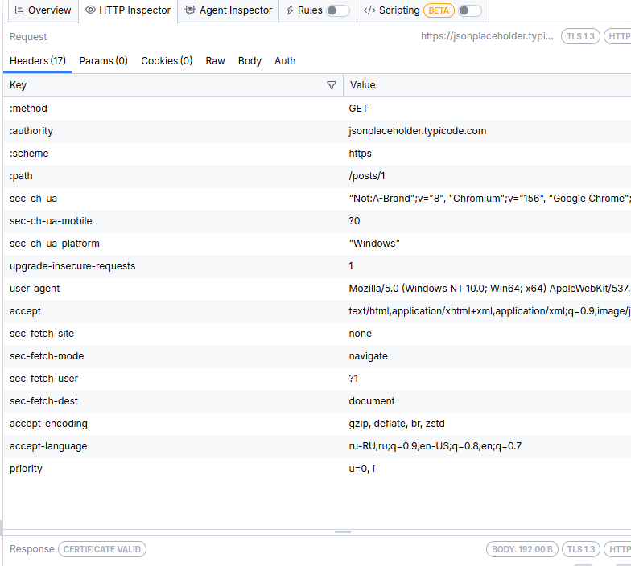
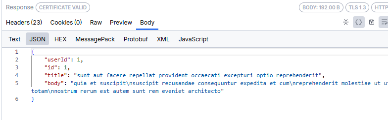

Сценарий 01: GET — получить пост и разобрать запрос/ответ
Цель: увидеть в Fiddler, из чего состоит обычный GET-запрос и ответ сервера
Инструмент Fiddler: Inspectors
Запрос: GET `https://jsonplaceholder.typicode.com/posts/1`
Предусловия
Fiddler запущен и перехватывает трафик (в нижней панели видно «Capturing»)
В списке сессий очищены старые записи (Ctrl+X)
Шаги
Открыть в браузере `https://jsonplaceholder.typicode.com/posts/1`.
В Fiddler найти сессию с хостом `jsonplaceholder.typicode.com`.
Выбрать её, справа открыть вкладку Inspectors.
В верхней части (Request) посмотреть метод, адрес и заголовки.
В нижней части (Response) посмотреть код ответа, заголовки и тело (вкладка JSON или Raw).
Сделать скриншот запроса и скриншот ответа.
Ожидаемый результат
Метод: GET
Код ответа: 200
Тело ответа: JSON-объект с полями `userId`, `id`, `title`, `body`, где `id` равен 1
Фактический результат
> Заполни сам после прохождения шагов.
Код ответа:
Заголовок Content-Type:
Время ответа:
Какие поля пришли в теле:
Что заметил интересного:
Статус: (Pass / Fail)
Скриншоты

