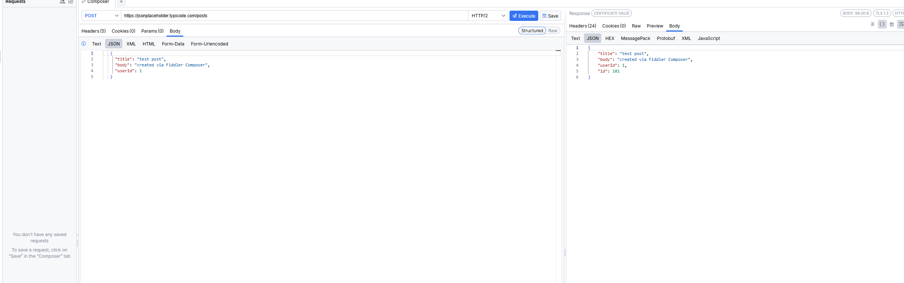
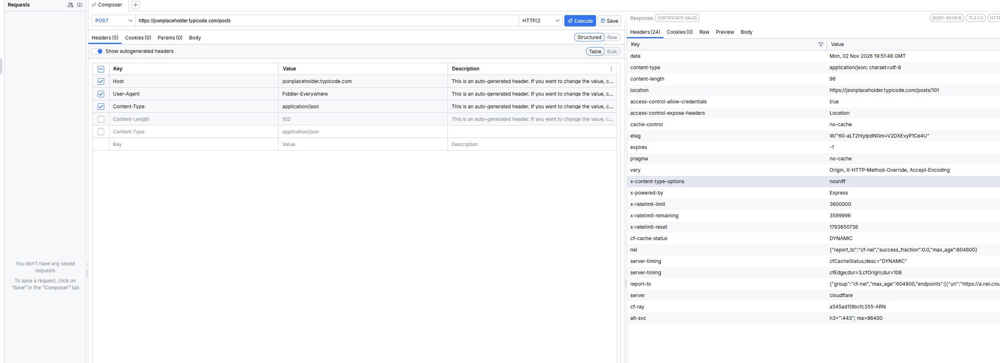
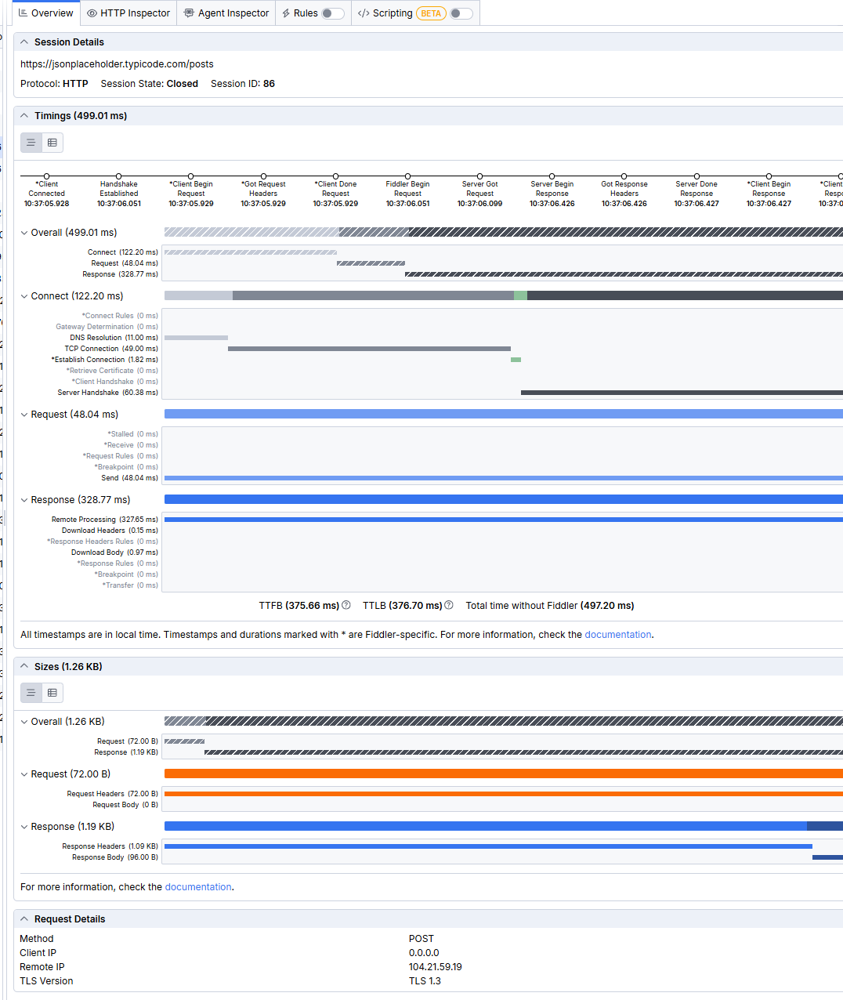
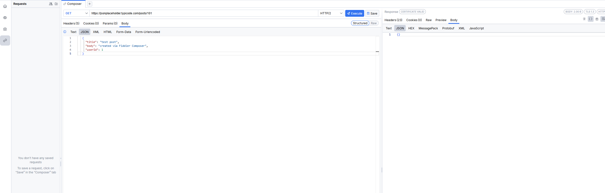

# Сценарий 02: POST — создать пост через Composer

**Цель:** самому собрать и отправить запрос на создание поста и разобрать ответ сервера.

**Инструмент Fiddler:** Composer (Fiddler Everywhere)

**Запрос:** `POST https://jsonplaceholder.typicode.com/posts`

## Предусловия

- Fiddler запущен.
- Открыта вкладка Composer (иконка со стрелками в левом меню).

## Шаги

1. В Composer выбрать метод `POST`, в поле адреса вставить `https://jsonplaceholder.typicode.com/posts`, протокол HTTP/2.
2. На вкладке Body выбрать тип JSON и вставить тело:
   ```json
   {
     "title": "test post",
     "body": "created via Fiddler Composer",
     "userId": 1
   }
   ```
3. На вкладке Headers проверить заголовки. `Content-Type: application/json` Fiddler подставляет сам при выборе типа JSON.
4. Нажать **Execute**.
5. Изучить ответ справа: код, заголовки (Headers) и тело (Body → JSON).
6. В Live Traffic найти сессию этого запроса и открыть Overview: посмотреть тайминги и размеры.
7. Проверить, сохранился ли пост: в Composer выполнить `GET https://jsonplaceholder.typicode.com/posts/101`.

## Ожидаемый результат

- Код ответа `201 Created`.
- В теле ответа те же поля, что были отправлены, плюс `id` (ожидается `101`).
- Заголовок `location` указывает на адрес созданного ресурса.
- `GET /posts/101` не находит пост: JSONPlaceholder только имитирует создание.

## Фактический результат

- **Метод и адрес:** `POST /posts`, HTTP/2, TLS 1.3
- **Заголовки запроса (отправлено):**
  - `Host: jsonplaceholder.typicode.com`
  - `User-Agent: Fiddler-Everywhere`
  - `Content-Type: application/json`
  - `Content-Length: 102`

  Все четыре создал Fiddler. Пятая строка с ручным `Content-Type` в таблице выключена, поэтому дубля в запросе нет. На скриншоте повторного запуска чекбокс у `Content-Length` снят, в первом запуске он был включён.
- **Код ответа:** `201`
- **Заголовок Content-Type ответа:** `application/json; charset=utf-8`
- **Заголовок Location:** `https://jsonplaceholder.typicode.com/posts/101`
- **Тело ответа:** `title`, `body`, `userId` без изменений и новое поле `id: 101`
- **Размер ответа:** тело 96 B, заголовки 1.09 KB (24 заголовка)
- **Время (сессия 86, вкладка Overview):**

  | Этап | Время |
  |---|---|
  | Всего | 499.01 мс |
  | Подключение (DNS 11.00, TCP 49.00, Server Handshake 60.38) | 122.20 мс |
  | Запрос | 48.04 мс |
  | Ответ | 328.77 мс |
  | TTFB / TTLB | 375.66 мс / 376.70 мс |

- **Проверка `GET /posts/101`:** тело ответа `{}` (2 B), 23 заголовка. Код ответа: _вписать из значка статуса справа вверху (ожидается 404)_. Пост не сохранён.
- **Что заметил интересного:**
  - Сервер вернул `id: 101`, но на самом деле ничего не сохранил: после создания поста `GET /posts/101` возвращает пустой объект.
  - Ответ на POST пришёл не из кеша (`cf-cache-status: DYNAMIC`, `cfOrigin;dur=265`), а у GET из сценария 01 был `HIT`. Поэтому ответ занял 328.77 мс против 33.34 мс.
  - При повторной отправке того же POST время обращения к серверу изменилось: `cfOrigin;dur=265` в первом запуске и `cfOrigin;dur=108` во втором. Время ответа заметно колеблется даже для одинакового запроса, и один замер ничего не доказывает.
  - В запросе из Composer нет браузерных заголовков (`sec-fetch-*`, `accept-language`) и нет `Accept-Encoding`. Вероятно, поэтому ответ пришёл без сжатия, в отличие от GET из браузера.
  - Запрос отправил сам Fiddler (процесс `fiddler.webui:18000`, Client IP `0.0.0.0`), а не браузер.
  - В `vary` появился `X-HTTP-Method-Override`.
  - Открытый вопрос: в Overview размер тела запроса указан как 0 B, хотя `Content-Length` равен 102. Причину не выяснил.
- **Статус:** Pass

## Скриншоты








