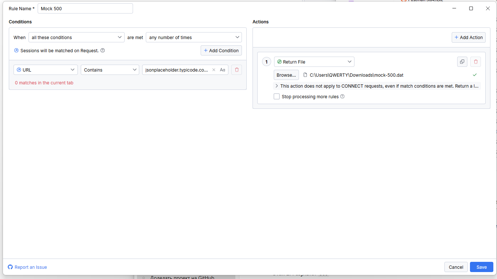
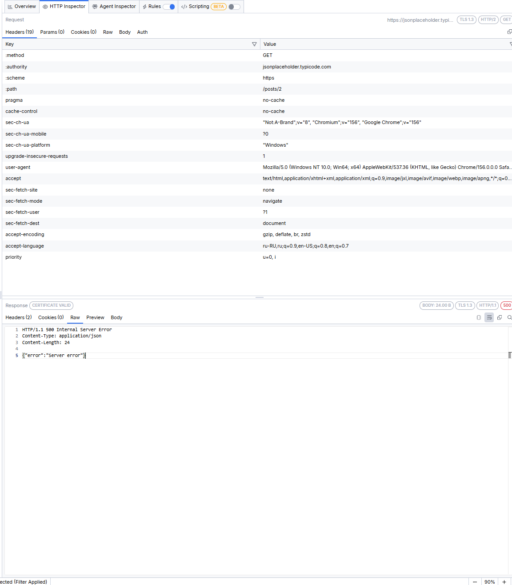
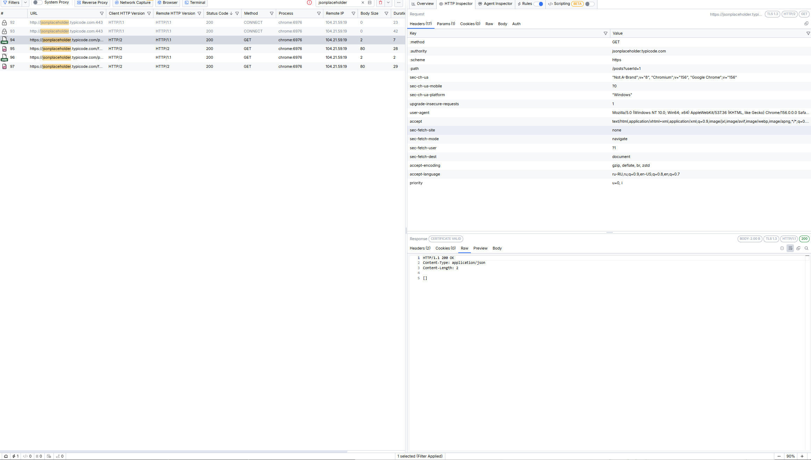
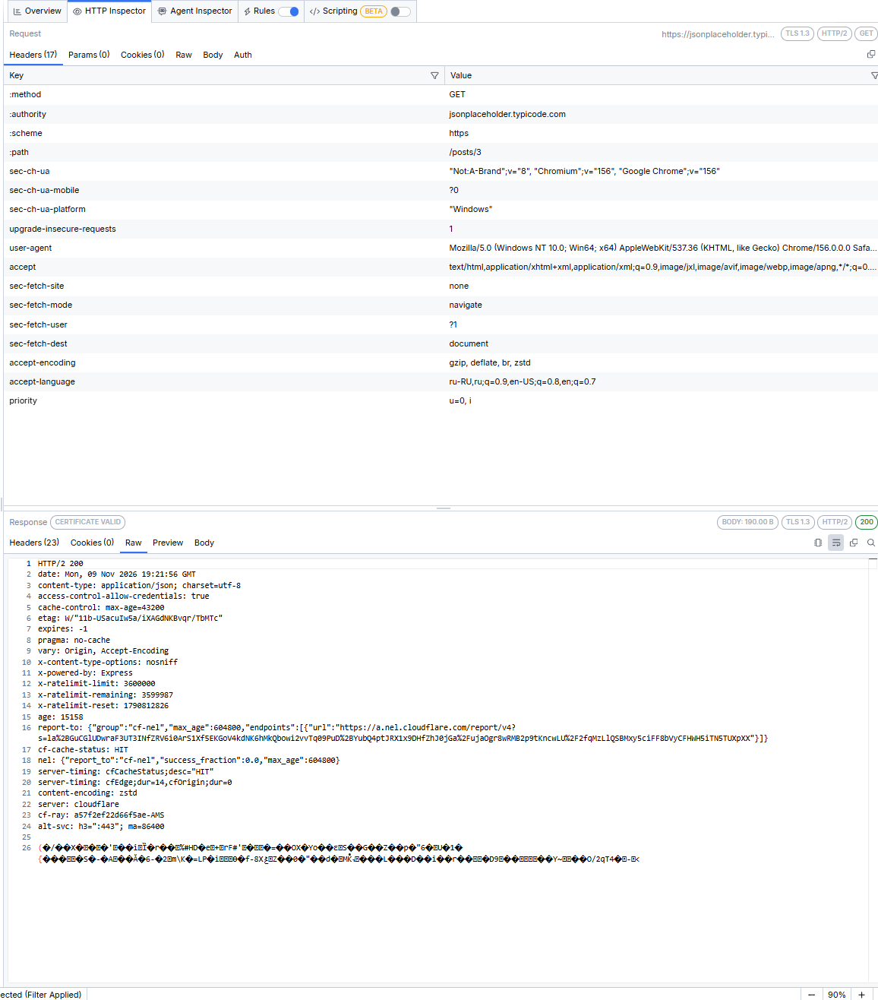

# Сценарий 04: подмена ответа сервера (500 и пустой список)

**Цель:** научиться отвечать на запрос вместо сервера и проверить, как выглядит подменённый ответ по сравнению с настоящим.

**Инструмент Fiddler:** Rules → Return File (Fiddler Everywhere; аналог AutoResponder)

**Запросы:**
- `GET https://jsonplaceholder.typicode.com/posts/2` → подменяем на `500`
- `GET https://jsonplaceholder.typicode.com/posts?userId=1` → подменяем на пустой список

## Предусловия

- Fiddler запущен и перехватывает трафик, расшифровка HTTPS включена.
- Запросы отправляются из браузера, открытого кнопкой **Browser** во Fiddler. Правила действуют только на новый трафик.
- Остальные правила выключены, список сессий очищен, в фильтре стоит `jsonplaceholder`.
- Подготовлены два файла ответа в формате HTTP. Строки в них разделены переводом строки в стиле Windows, перед телом стоит пустая строка.

`mock-500.dat`:

```
HTTP/1.1 500 Internal Server Error
Content-Type: application/json
Content-Length: 24

{"error":"Server error"}
```

`mock-empty.dat`:

```
HTTP/1.1 200 OK
Content-Type: application/json
Content-Length: 2

[]
```

## Шаги

1. На вкладке **Rules** нажать **Add Rule**, назвать правило `Mock 500`.
2. Условие: **URL — Contains — `jsonplaceholder.typicode.com/posts/2`**. По умолчанию в новом правиле стоит заготовка `http://www.example.com/`, её нужно заменить.
3. Действие: **Return File**, выбрать `mock-500.dat`. Нажать **Save** и включить правило.
4. Аналогично создать правило `Mock empty list`: условие **URL — Contains — `jsonplaceholder.typicode.com/posts?userId=1`**, действие **Return File** с файлом `mock-empty.dat`.
5. В браузере Fiddler открыть `https://jsonplaceholder.typicode.com/posts/2` и нажать `Ctrl+F5`.
6. В Fiddler выбрать сессию `GET /posts/2`, в HTTP Inspector открыть Response → **Raw**.
7. Выключить `Mock 500`, включить `Mock empty list`, открыть `https://jsonplaceholder.typicode.com/posts?userId=1`, снова посмотреть Response → **Raw**.
8. Для сравнения открыть `https://jsonplaceholder.typicode.com/posts/3` (правила на этот адрес не действуют) и посмотреть настоящий ответ сервера.
9. Выключить правила.

## Ожидаемый результат

- На `/posts/2` приходит `500` с телом `{"error":"Server error"}`.
- На `/posts?userId=1` приходит `200` с пустым списком `[]`.
- Настоящий сервер при этом не участвует: в ответе только заголовки из файла.

## Фактический результат

- **Подмена 500 (`/posts/2`):** код `500`, тело 24 B (`{"error":"Server error"}`), 2 заголовка (`Content-Type: application/json`, `Content-Length: 24`).
- **Подмена пустого списка (`/posts?userId=1`):** код `200`, тело 2 B (`[]`), 2 заголовка.
- **Настоящий ответ (`/posts/3`, правила на этот адрес не действуют):** код `200`, тело 190 B (сжато, `content-encoding: zstd`), 23 заголовка (`server: cloudflare`, `x-powered-by: Express`, `cf-cache-status: HIT` и другие).
- **Время:** подменённые ответы пришли за 2–7 мс, настоящие запросы в предыдущих сценариях занимали десятки и сотни миллисекунд.
- **Что заметил интересного:**
  - Подменённый ответ сразу отличить по списку сессий: клиентский протокол HTTP/2, а Remote HTTP Version `HTTP/1.1`, длительность 1–7 мс, у ответа только 2 заголовка вместо 23 (нет заголовков Cloudflare и `x-powered-by`).
  - В колонке Remote IP у подменённых сессий всё равно стоит адрес сервера, хотя ответ сформировал сам Fiddler.
  - Поле ручного ввода у действия **Return Manual Response** искажает переводы строк: заголовки и тело слипаются, Fiddler сам дописывает лишний `Content-Length`, а тело пропадает. Статус `500` при этом подменялся, но тело терялось. Выручил файл ответа (**Return File**) с правильными переводами строк.
  - Если Fiddler не находит выбранный файл, он сам отвечает кодом `404` и коротким телом (512 B), и это легко принять за ответ сервера. Файл лучше хранить в простой папке, например `C:\fiddler-mocks`.
  - У нового правила в условии стоит заготовка `http://www.example.com/`: если её не заменить, правило ни на что не реагирует и все запросы идут к настоящему серверу.
  - Помимо нужных запросов, Chrome сам запрашивает `/favicon.ico`. Правила его не затрагивают: он приходит с настоящего сервера (80 B, `HTTP/2`).
- **Статус:** Pass

## Скриншоты








