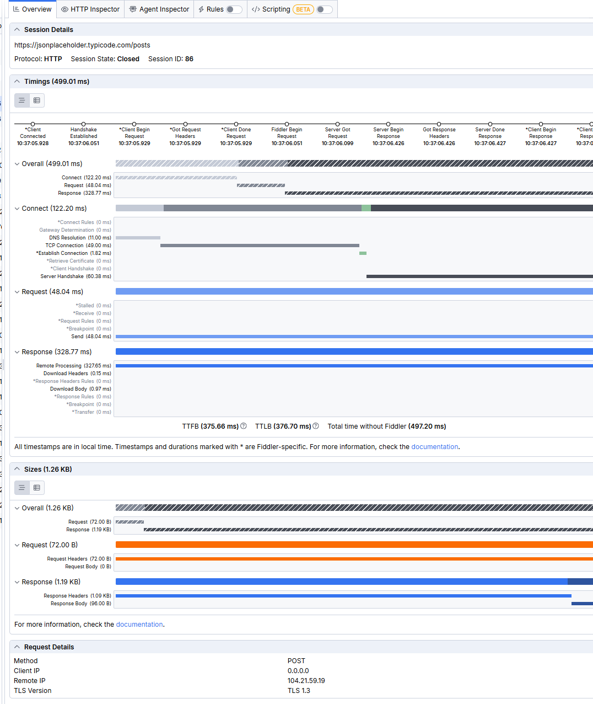
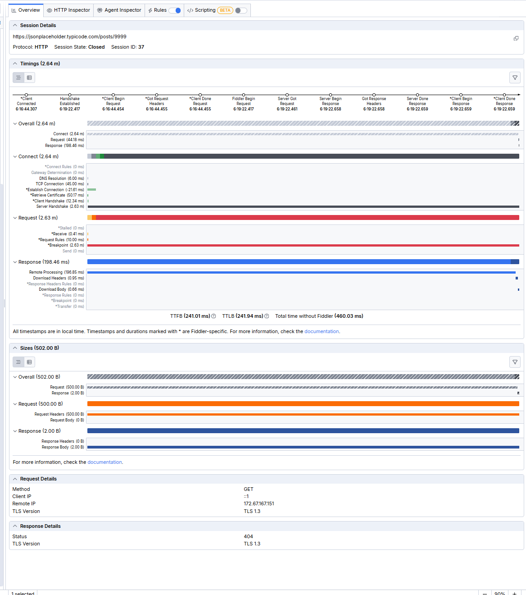

# Сценарий 05: анализ времени ответа

**Цель:** научиться читать тайминги запроса во Fiddler и понять, из чего складывается время ответа и от чего оно зависит.

**Инструмент Fiddler:** вкладка Overview (разделы Timings и Sizes) в Fiddler Everywhere

**Данные:** замеры, снятые в сценариях 01–03. Отдельных новых запросов этот сценарий не требует.

## Предусловия

- Выполнены сценарии 01–03, в которых сняты тайминги (Overview) для запросов:
  - GET `/posts/1` из браузера;
  - POST `/posts` из Composer;
  - GET `/posts/9999` с точкой останова.

## Шаги

1. Выбрать сессию в списке и открыть вкладку **Overview**.
2. В разделе **Timings** найти общее время (Overall) и его части: Connect, Request, Response.
3. В разделе Connect посмотреть, из чего состоит подключение: DNS, TCP, рукопожатие с сервером. Шаги со звёздочкой (`*`) выполняет сам Fiddler.
4. Записать TTFB (время до первого байта), TTLB (до последнего байта) и «Total time without Fiddler».
5. Повторить для остальных сессий и сравнить значения в таблице.

## Ожидаемый результат

- Основную часть времени занимает не передача данных, а подключение и ожидание ответа сервера.
- Ответ из кеша быстрее ответа, который сервер формирует сам.

## Фактический результат

| Показатель | GET `/posts/1` (браузер) | POST `/posts` (Composer) | GET `/posts/9999` (breakpoint) |
|---|---|---|---|
| Всего (Overall) | 193.61 мс | 499.01 мс | 2.64 мин |
| Подключение (Connect) | 135.58 мс | 122.20 мс | 2.64 мин |
| Запрос (Request) | 24.69 мс | 48.04 мс | 2.63 мин (из них Breakpoint 2.63 мин) |
| Ответ (Response) | 33.34 мс | 328.77 мс | 198.46 мс |
| TTFB | 32.61 мс | 375.66 мс | 241.01 мс |
| TTLB | 33.18 мс | 376.70 мс | 241.94 мс |
| Без учёта Fiddler | 103.85 мс | 497.20 мс | 460.03 мс |
| Кеш Cloudflare | `HIT` | `DYNAMIC` | `HIT` |

Подмена ответа (сценарий 04) приходит быстрее всего: 1–7 мс в колонке Duration, потому что сервер не участвует.

- **Что заметил интересного:**
  - Подключение (DNS, TCP, TLS) занимает 120–135 мс почти независимо от запроса. Это самая дорогая часть для коротких ответов.
  - Ответ из кеша Cloudflare (GET) занял 33.34 мс, а POST, который обрабатывал сам сервер, 328.77 мс. Время ответа зависит от кеша, а не от размера данных.
  - TTFB и TTLB почти совпадают (разница меньше миллисекунды у GET и POST): тело короткое и скачивается мгновенно.
  - «Без Fiddler» время меньше, чем общее: у GET 103.85 мс против 193.61 мс. Часть времени уходит на перехват HTTPS (получение сертификата 50.38 мс и рукопожатие с клиентом 12.26 мс). У запроса из Composer эти шаги равны 0 мс, и общее время почти совпадает с «без Fiddler» (499.01 и 497.20 мс).
  - Время удержания запроса на breakpoint попадает в тайминги целиком (минуты), поэтому такие замеры нельзя использовать для оценки скорости сервера. Показательна только часть Response (198.46 мс).
  - Один замер ненадёжен: у одного и того же POST время обращения к серверу (`cfOrigin;dur`) было 265 мс и 108 мс.
- **Статус:** Pass

## Скриншоты

